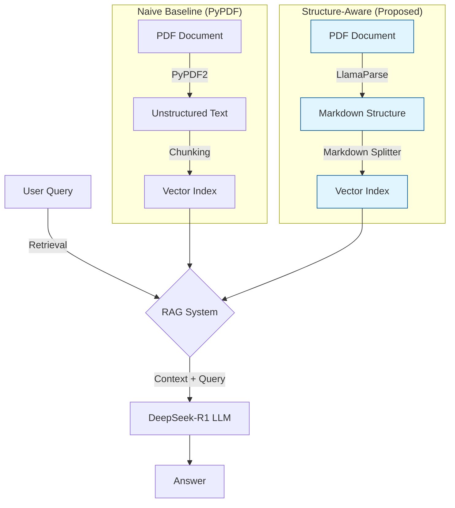
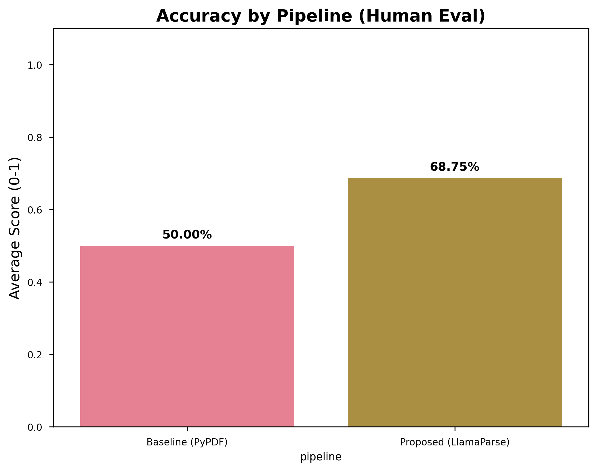
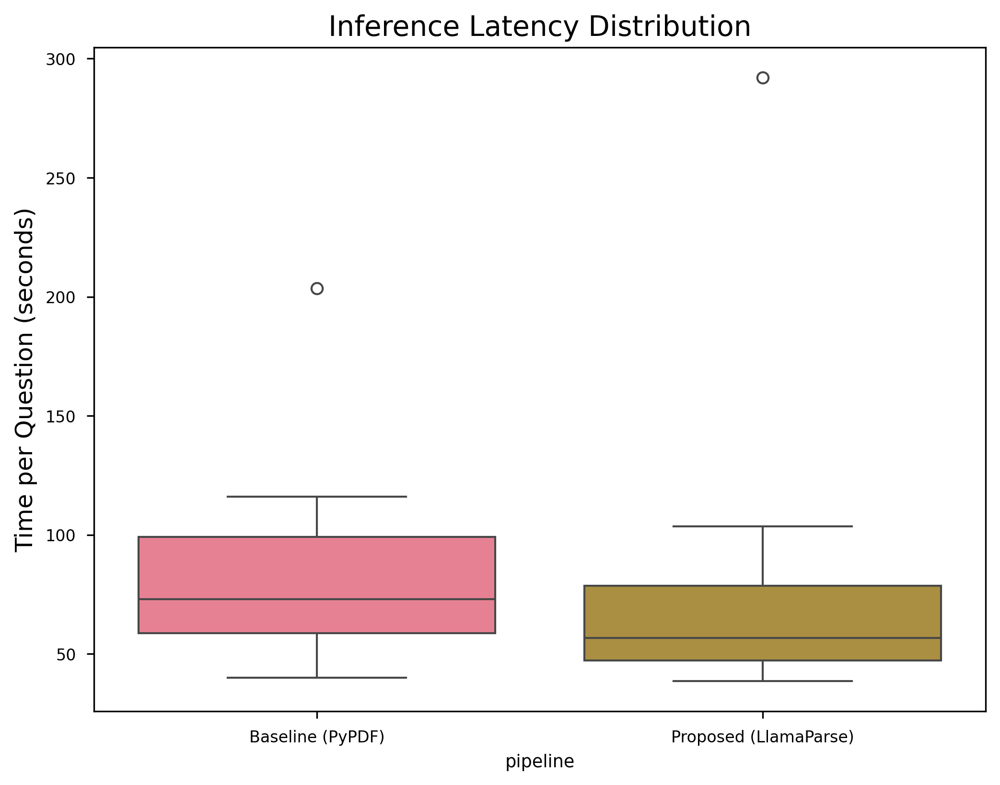

# 📊 Structure-Aware RAG: An Empirical Study on Financial Document Parsing

[](https://www.python.org/)
[](LICENSE)
[](Dockerfile)
[](https://github.com/psf/black)
[](https://www.llamaindex.ai/)
[](https://github.com/Zhi-Chao-PAN/structure-aware-rag-empirical/stargazers)
[](https://github.com/Zhi-Chao-PAN/structure-aware-rag-empirical/issues)
[](https://huggingface.co/Zhi-Chao-PAN)

An exploratory comparison of plain-text and Markdown-aware parsing for financial-document RAG, with a public question bank and an analysis of retrieval and answer failures.

> **Evidence scope:** The repository contains 30 questions from one NVIDIA annual report. The historical results below summarize **8 scored items**, with partial credit; they are not a completed 30-question evaluation. Per-answer result and scoring CSVs are not committed, so the reported values cannot be independently recomputed from this checkout alone. No new benchmark was run for this documentation correction.

<p align="center">
  
  
  
</p>

---

## 📋 Table of Contents
- [Executive Summary](#-executive-summary)
- [Motivation](#-motivation)
- [Experimental Design](#-experimental-design)
- [Key Results](#-key-results)
- [Technical Highlights](#-technical-highlights)
- [Project Structure](#-project-structure)
- [How to Reproduce](#-how-to-reproduce)
- [Technical Skills Demonstrated](#-technical-skills-demonstrated)
- [References](#-references)
- [Community & Contact](#-community--contact)
- [License](#-license)

---

## ⚡ Executive Summary

**Problem**: Flattening financial tables into plain text can obscure row and column relationships needed for retrieval and numerical reasoning.

**Solution**: This project implements a **Structure-Aware Parsing Pipeline** using Markdown-based document representation and compares it against a **Naive Baseline** using unstructured text extraction.

**What this study covers**: An A/B parsing pipeline, a 30-question bank, and a preliminary 8-item result summary. The reported examples motivate preserving table structure while also examining retrieval failures, unit handling, and ambiguity between related financial terms. They do not establish general accuracy or production readiness.

> 📄 **[Read the Full Technical Report →](report/README.md)**

---

## 🎯 Motivation

Financial documents (10-K filings, earnings reports, balance sheets) are **highly heterogeneous** and rely heavily on complex tables to convey critical numerical information. When these tables are flattened into plain text by standard PDF extractors, the spatial relationships between headers, rows, and values are destroyed.

This creates what we term the **"Structure-Gap"** — a fundamental mismatch between how humans interpret tabular data and how LLMs receive it through naive text pipelines.

**Research Question**: *Can preserving document structure through Markdown-based parsing significantly improve RAG accuracy on financial reasoning tasks?*

### The "Structure Gap" Visualized

<details>
<summary>🔍 Click to see why Naive RAG fails on tables</summary>

The following is an illustrative representation, not a retained raw parser output.

**Plain-text representation:**
```text
Consolidated Statements of Income Year Ended Jan 28 2024 Jan 29 2023 
Revenue $60,922 $26,974 ...
```
> ⚠️ *Columns are merged, numbers lose alignment, headers detached from values*

**Markdown table representation:**
```markdown
| Year Ended | Jan 28, 2024 | Jan 29, 2023 |
| :--- | ---: | ---: |
| **Revenue** | **$60,922** | **$26,974** |
```
> The table representation makes the year-to-value relationship explicit.

</details>

---

## 🏗️ System Architecture



---

## 🧪 Experimental Design

| Component | Baseline (Control) | Proposed (Experiment) |
| :--- | :--- | :--- |
| **Document Parsing** | PyPDF2 (Unstructured Text) | **LlamaParse (Markdown Structure)** |
| **Vector Indexing** | Dense Vector Index (BGE-Large) | Dense Vector Index (BGE-Large) |
| **LLM Reasoning** | DeepSeek-R1 8B (Local) | DeepSeek-R1 8B (Local) |
| **Reported evaluation** | 8 scored items, partial credit | 8 scored items, partial credit |

### Dataset
- **Source**: [NVIDIA Corporation Fiscal Year 2024 Annual Report (10-K Filing)](https://investor.nvidia.com/financial-info/sec-filings/default.aspx) | [SEC filing](https://www.sec.gov/Archives/edgar/data/1045810/000104581024000029/nvda-20240128.htm)
- **Focus**: Financial tables and related numerical disclosures
- **Question bank**: [30 curated questions](data/benchmark/golden_dataset.csv): 20 Simple Lookup and 10 Cross-Column Comparison items. This is the available bank, not the denominator of the historical results.

---

## 📈 Key Results

<p align="center">
  
  
</p>

These historical values are preserved from the [technical report](report/README.md#31-aggregate-performance). The denominator is 8 items and the score includes half credit; this is not a binary exact-match accuracy result for the full question bank.

| Metric | Baseline | Proposed |
|--------|----------|----------|
| **Mean score, including partial credit** | 50.0% (4/8) | 68.8% (5.5/8) |
| **Simple Lookup score** | 50.0% | 75.0% |
| **Cross-Column score** | 50.0% | 62.5% |
| **Avg. Latency (reported)** | 89.4s | 88.4s |

The original relative score change is +37.5%, calculated from 4/8 and 5.5/8 before rounding. It is a descriptive result for this small historical evaluation, not evidence of statistical significance or generalization.

The report describes manual scoring with a ±1% numerical tolerance and partial credit. The bundled automatic scorer uses number/token matching and is not an implementation of that same rubric; its output requires manual review. Per-answer records and a reconciled scoring protocol are needed before claiming a reproducible result over all 30 questions. The charts above are historical report artifacts, not a fresh verification run.

### Key Insights
1. **Parsing is one part of the pipeline**: Preserving table structure can help retrieval and interpretation, but it does not resolve every failure mode.
2. **Evidence remains preliminary**: The published aggregate covers 8 scored items from one document; a larger, documented evaluation is needed.
3. **Failure analysis guides next steps**: The report discusses retrieval misses, unit confusion, and ambiguity between "Basic" and "Diluted" EPS.

---

## 🛠️ Technical Highlights

| Feature | Description |
|---------|-------------|
| **Fault Tolerance** | Implemented `SafeMode` with incremental checkpointing ([run_comparison.py](src/experiments/run_comparison.py)) |
| **Resource Management** | Aggressive GPU memory garbage collection for consumer-grade hardware ([hardware_config.py](config/hardware_config.py)) |
| **Async Processing** | Asyncio-based concurrent evaluation with configurable parallelism |
| **Reproduction materials** | Question bank, evaluation scripts, and configuration files provided; historical per-answer result CSVs are not committed |

---

## 📁 Project Structure

```
structure-aware-rag-empirical/
├── src/
│   ├── parsing/           # Document parsing pipelines
│   │   └── generate_datasets.py
│   ├── experiments/       # Experiment runners
│   │   └── run_comparison.py
│   └── evaluation/        # Scoring and visualization
│       ├── auto_score.py
│       └── visualize.py
├── config/
│   └── hardware_config.py # Hardware optimization settings
├── scripts/
│   ├── init_project.py    # Project initialization
│   └── verify_hardware.py # GPU/CUDA verification
├── data/
│   ├── raw_pdfs/          # Source documents
│   ├── benchmark/         # Golden dataset (Q&A pairs)
│   ├── parsed/            # Parsed outputs (gitignored)
│   └── chroma_db/         # Vector index (gitignored)
├── experiments/           # Generated locally; historical CSVs are not committed
│   ├── comparison_results.csv
│   └── scored_results.csv
├── report/                # Technical report & visualizations
│   ├── README.md          # Full technical report
│   ├── accuracy_comparison.png
│   └── latency_distribution.png
├── requirements.txt
├── LICENSE
└── README.md
```

---

## 🚀 How to Reproduce

### Prerequisites
- Python 3.10+
- [Ollama](https://ollama.com/) installed (for local LLM inference)
- CUDA-compatible GPU recommended (tested on RTX 4060)

### Quick Start

1.  **Setup Local LLM**
    ```bash
    # Install Ollama from https://ollama.com/, then:
    ollama pull deepseek-r1:8b
    ```

2.  **Clone Repository**
    ```bash
    git clone https://github.com/Zhi-Chao-PAN/structure-aware-rag-empirical.git
    cd structure-aware-rag-empirical
    ```

3.  **Install Dependencies**
    ```bash
    # Install in editable mode (enables 'structure-rag' command)
    pip install -e .
    ```

4.  **Configure Environment**
    ```bash
    cp .env.example .env
    # Add your **LlamaParse API key** to .env
    # ⚠️ NOTE: LlamaParse uploads data to the cloud. Do not use for highly sensitive/PII data.
    ```

5.  **Run with Professional CLI**
    ```bash
    # View all commands using the new entry point
    structure-rag --help
    
    # Check your hardware environment
    structure-rag verify

    # Run comparison experiment
    structure-rag experiment --safe

    # Parse documents
    structure-rag parse

    # Generate visualizations
    structure-rag visualize
    ```

6.  **Run with Docker (Optional)**
    ```bash
    # Build container
    docker build -t structure-rag .

    # Run experiment inside container
    docker run --rm --gpus all -v $(pwd)/data:/app/data structure-rag experiment
    ```

---

## 🎓 Technical Skills Demonstrated

This project showcases proficiency in:

| Domain | Skills |
|--------|--------|
| **NLP/LLM** | RAG pipeline design, prompt engineering, local LLM deployment (Ollama) |
| **ML Engineering** | Vector embeddings (HuggingFace), similarity search, GPU optimization |
| **Software Engineering** | Async programming, fault-tolerant design, checkpoint/resume patterns |
| **Data Science** | Experimental design, statistical evaluation, data visualization (Matplotlib/Seaborn) |
| **Research Methods** | Ablation studies, controlled experiments, reproducibility practices |

---

## 📚 References

1. Lewis, P., et al. (2020). *Retrieval-Augmented Generation for Knowledge-Intensive NLP Tasks*. NeurIPS.
2. Liu, J., et al. (2024). *LlamaIndex: A Data Framework for LLM Applications*. [llamaindex.ai](https://www.llamaindex.ai/)
3. Xiao, S., et al. (2023). *BGE: BAAI General Embedding*. arXiv:2309.07597
4. NVIDIA Corporation. (2024). *Annual Report (Form 10-K)*. SEC Filing.

---

## 🤝 Community & Contact

### 📬 Contact Information
- **Author**: Zhichao Pan
- **Website & contact**: [panzhichao.com](https://www.panzhichao.com)
- **GitHub**: [@Zhi-Chao-PAN](https://github.com/Zhi-Chao-PAN)

### 🗣️ Community Engagement
- **Issues**: [Report bugs or request features](https://github.com/Zhi-Chao-PAN/structure-aware-rag-empirical/issues)
- **Discussions**: [Join technical discussions](https://github.com/Zhi-Chao-PAN/structure-aware-rag-empirical/discussions)
- **Contributing**: See [CONTRIBUTING.md](CONTRIBUTING.md) for guidelines
- **Code of Conduct**: [View our community guidelines](CODE_OF_CONDUCT.md)

### ⭐ Support
If this research helps you, please give it a star! ⭐

---

## 📝 Citation

If you use this repository, cite the software and include the commit you used. This project does not claim a linked arXiv publication or a verified DOI.

```bibtex
@misc{pan2026structureaware,
  author = {Zhichao Pan},
  title = {Structure-Aware RAG: An Empirical Study on Financial Document Parsing},
  year = {2026},
  publisher = {GitHub},
  howpublished = {\url{https://github.com/Zhi-Chao-PAN/structure-aware-rag-empirical}}
}
```

---

## 📄 License

This project is licensed under the MIT License - see the [LICENSE](LICENSE) file for details.

---

<p align="center">
  <i>Developed as part of independent research on RAG systems for financial document analysis.</i>
</p>

<p align="center">
  Made with ❤️ by <a href="https://github.com/Zhi-Chao-PAN">ZhiChao Pan</a> | 
  <a href="https://github.com/Zhi-Chao-PAN/structure-aware-rag-empirical">View on GitHub</a> |
  <a href="report/README.md">Read the Technical Report</a>
</p>
