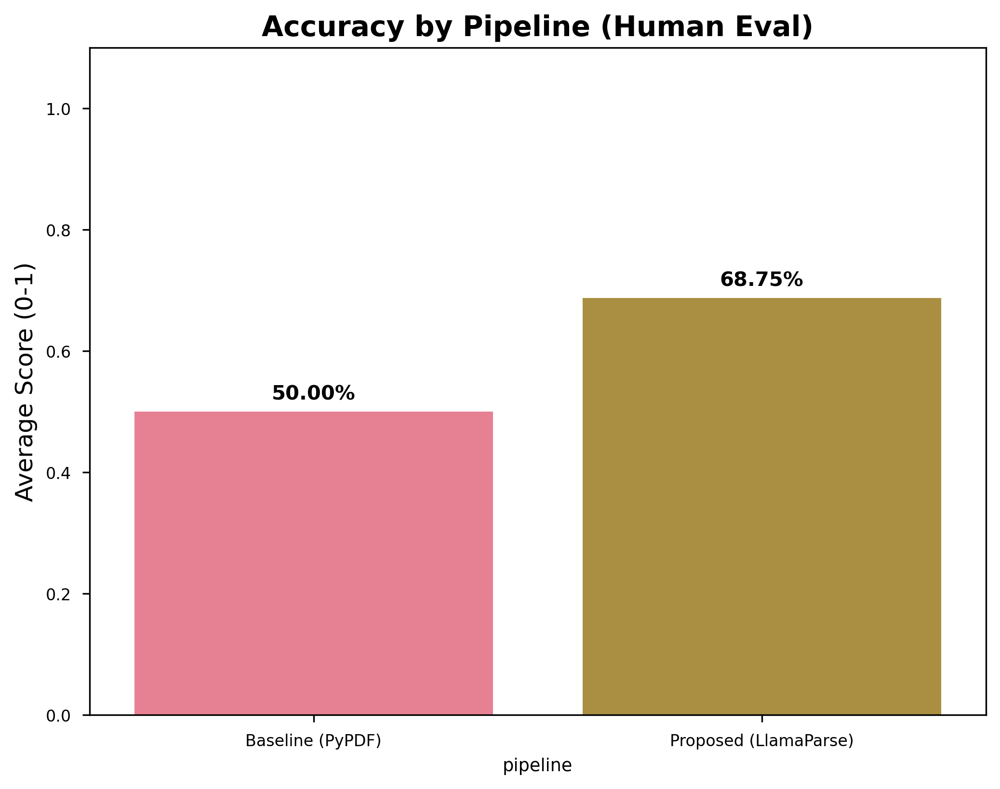
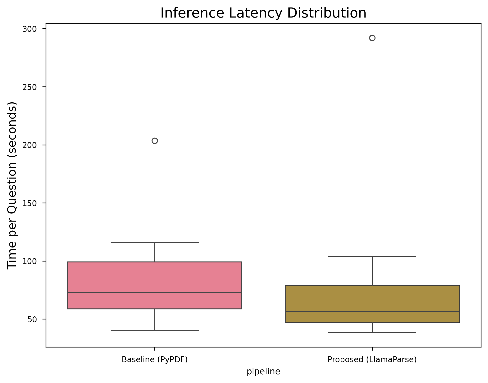

# Bridging the Structure-Gap: An Empirical Study on Layout-Aware Parsing for Financial RAG

<strong>Zhichao Pan</strong>

<em>Independent Research</em>

January 2026

> **Evidence note (September 2026):** This is a historical exploratory report. The public question bank contains 30 items; the result table below reports **8 scored items with partial credit**. Per-answer result and scoring CSVs are not committed, so the aggregate cannot be independently recomputed from this checkout alone. The result table has been preserved, and this documentation correction does not represent a new experiment.

---

## Abstract

**Problem Definition.** Financial documents, such as Form 10-K filings and earnings reports, rely heavily on complex tables to convey critical numerical information. Standard Retrieval-Augmented Generation (RAG) pipelines, which treat documents as unstructured flat text, systematically fail to preserve the spatial relationships within these tables. We term this fundamental mismatch between the *geometric layout* of source documents and their *linearized text representation* the **"Structure-Gap."** This gap leads to semantic collision—where visually distinct data points become ambiguous in text—and is a primary driver of hallucination in financial question-answering (QA) tasks.

**Proposed Method.** We propose a **Layout-Aware Parsing Pipeline** that leverages **Vision-Language Model (VLM) based document parsing** to extract source PDFs into **Markdown-serialized** text, explicitly preserving tabular structure as machine-readable Markdown tables. This representation is then chunked and indexed using standard dense retrieval.

**Results.** The historical 8-item summary reports a mean score of **68.8%** (5.5/8, including partial credit), compared with **50.0%** (4/8) for the unstructured baseline. The corresponding relative score change is **+37.5%** before rounding. These values are preliminary, are not a completed evaluation of the 30-question bank, and do not establish statistical significance. Three discussed failure cases concern retrieval, generation, and semantic ambiguity; they illustrate possible next steps rather than a general error distribution.

---

## 1. Introduction

### 1.1 The Structure-Gap Problem

Financial documents are inherently **semi-structured**. A Consolidated Statement of Income is not merely a paragraph of text; it is a precisely formatted table where the spatial position of a value (e.g., the cell at the intersection of "Revenue" and "FY2024") is semantically critical. When a standard PDF extractor (e.g., PyPDF2) linearizes this table into a "bag of words," the row-column associations are destroyed.

Consider the following example from the NVIDIA 10-K:

**Table 1: Parsing Quality Comparison**

| Parser | Output Snippet | Structure Preserved? |
|:---|:---|:---:|
| **Unstructured (PyPDF2)** | `Revenue $60,922 $26,974 ... Gross margin 72.7% 56.9%` | ❌ No |
| **Layout-Aware (VLM)** | `| Metric | FY2024 | FY2023 |` `|---|---|---|` `| Revenue | $60,922 | $26,974 |` | ✅ Yes |

The Unstructured output juxtaposes values from different rows and columns, creating **semantic collision**: the LLM cannot reliably determine which value belongs to which year. The Layout-Aware output, by serializing the table into Markdown, provides an explicit row-column schema that the LLM's attention mechanism can leverage.

### 1.2 Our Contributions

1.  **Formal Definition of the Structure-Gap.** We articulate the problem of spatial information loss in document linearization as a distinct failure mode in RAG pipelines for semi-structured data.
2.  **Layout-Aware Parsing Pipeline.** We propose and implement a pipeline using VLM-based Markdown serialization to preserve tabular structure.
3.  **Rigorous Error Analysis.** Beyond aggregate accuracy, we provide a fine-grained **Failure Mode Analysis** (Section 4) that categorizes errors into Retrieval, Generation, and Embedding failures, offering actionable insights for future research.

---

## 2. Methodology

### 2.1 Experimental Design

We employ a controlled A/B experimental design with the following fixed parameters:

| Component | Configuration |
|:---|:---|
| **Embedding Model** | BAAI/bge-large-en-v1.5 (HuggingFace) |
| **LLM (Generation)** | DeepSeek-R1 8B (Local, via Ollama) |
| **Vector Store** | Local Chroma DB |
| **Top-K Retrieval** | k=3 |

The **independent variable** is the **document parsing strategy**:
-   **Unstructured Baseline**: PyPDF2 plain-text extraction → recursive character chunking.
-   **Layout-Aware (Proposed)**: VLM-based parser (LlamaParse) → Markdown output → Markdown-aware chunking.

### 2.2 Benchmark Dataset

-   **Source Document**: [NVIDIA Corporation FY2024 Annual Report (Form 10-K)](https://www.sec.gov/Archives/edgar/data/1045810/000104581024000029/nvda-20240128.htm) — a document characterized by complex multi-column tables and dense numerical data.
-   **Public Question Bank**: [30 curated QA pairs](../data/benchmark/golden_dataset.csv) spanning two task types:
    -   **Simple Lookup** (20 questions): Direct extraction of a value or statement.
    -   **Cross-Column Comparison** (10 questions): Comparison across values or cells.
-   **Reported Evaluation**: The aggregate in Section 3 uses 8 items. The repository does not include the per-answer scoring records needed to verify the exact subset or recompute the result.

### 2.3 Evaluation Metrics

| Metric | Definition |
|:---|:---|
| **Mean score, including partial credit** | The historical report describes `1.0` for a numerical answer within ±1%, `0.5` for correct methodology with a close but inexact answer, and `0.0` otherwise. Because partial credit is included, this is not a binary exact-match accuracy metric. |
| **Latency** | End-to-end wall-clock time from query submission to final answer (in seconds). |

The bundled [`auto_score.py`](../src/evaluation/auto_score.py) uses number/token matching and partial matches; it does not implement the report's stated ±1% rubric. Its output requires manual review. A reproducible rerun needs one documented scoring protocol and retained per-answer records.

---

## 3. Results

### 3.1 Aggregate Performance

**Table 2: Historical Results Summary (8 scored items; values preserved)**

| Pipeline | Mean Score | Simple Lookup | Cross-Column | Avg. Latency (s) |
|:---|:---:|:---:|:---:|:---:|
| **Unstructured Baseline** | 50.0% (4/8) | 50.0% | 50.0% | 89.4 |
| **Layout-Aware (Proposed)** | **68.8%** (5.5/8) | **75.0%** | **62.5%** | 88.4 |
| **Δ (Relative Improvement)** | **+37.5%** | +50.0% | +25.0% | -1.1% |

The reported scores are higher for layout-aware parsing in this small evaluation. Without the per-answer records, repeated runs, or a statistical analysis, the table supports a descriptive historical comparison only. It does not establish significance or performance across the full question bank or other documents.

### 3.2 Visual Summary

  
  

*Figure 1: Historical score and latency charts retained from the original report. These are not evidence of a fresh run or a statistical latency comparison; the original per-answer records are not committed.*

---

## 4. Failure Mode Analysis

The report discusses three cases that did not receive full credit, including one partial-credit answer. These case counts are different from the score shortfall: the 5.5/8 score leaves a 31.25% score shortfall, not a 31.25% binary error rate. The descriptions below are preserved as qualitative failure analysis; the original answers are not committed for independent review.

### 4.1 Error Taxonomy

**Table 3: Three Reported Failure Cases (including one partial-credit answer)**

| Question ID | Task Type | Failure Mode | Root Cause |
|:---|:---|:---|:---|
| **Q3** | Cross-Column | **Retrieval Failure** | The relevant chunk (R&D expenses table) was not retrieved in the top-k results. The embedding model failed to rank it highly enough given the query. |
| **Q4** | Simple Lookup | **Generation Error** | Correct data was retrieved; however, the LLM's chain-of-thought reasoning introduced arithmetic confusion regarding units (millions vs. billions), leading to a slightly inexact final answer. (Partial credit awarded.) |
| **Q7** | Simple Lookup | **Semantic Ambiguity** | The query asked for "Basic" EPS, but the retrieved chunk contained "Diluted" EPS. The dense embedding model could not distinguish the fine-grained semantic difference between these near-synonymous terms. |

### 4.2 Implications for Future Research

This analysis yields three actionable insights:

1.  **Retrieval is a Bottleneck (Q3).** Even with perfect parsing, if the retriever fails to surface the correct chunk, the generation layer can only hallucinate. This motivates hybrid retrieval strategies (e.g., BM25 + dense) or query expansion.

2.  **LLM Arithmetic is Unreliable (Q4).** For financial applications requiring precise numerical answers, a dedicated calculation layer (e.g., chaining the LLM with a code interpreter) may be necessary to avoid generation-time errors.

3.  **Semantic Ambiguity Defeats Dense Embeddings (Q7).** When two terms (e.g., "Basic" vs. "Diluted" EPS) are semantically near-identical in general language but critically distinct in a domain context, dense embeddings fail. This strongly suggests the need for **late-interaction retrieval models** (e.g., ColBERT) or **domain-adapted embeddings** for financial NLP.

---

## 5. Discussion and Limitations

### 5.1 Generalizability

The study uses a **single document** (NVIDIA FY2024 10-K), and the historical aggregate covers only 8 scored items. Missing per-answer records and differing manual/automatic scoring rules further limit independent verification. Before extending conclusions to other reports, a follow-up should reconcile the scoring protocol, retain raw answers and scores, evaluate the full public bank, and then add diverse documents.

### 5.2 Baseline Strength

We acknowledge that PyPDF2 represents a minimal baseline. Stronger comparisons against more capable parsers—such as Unstructured.io, dedicated OCR engines (e.g., Tesseract, PaddleOCR), or even GPT-4 Vision-based extraction—would provide a more rigorous assessment of where the Layout-Aware approach sits on the Pareto frontier of performance and cost.

### 5.3 On the Role of Proprietary Tools

This study utilizes LlamaParse, a commercial API, as the VLM-based parser. We deliberately frame our contribution not as an endorsement of a specific tool, but as evidence for the general principle of **Markdown Serialization** as a powerful intermediate representation for semi-structured documents. The core insight—that preserving layout structure benefits downstream LLM reasoning—is tool-agnostic and replicable with open-source VLMs (e.g., Nougat, Pix2Struct).

---

## 6. Conclusion

This exploratory project compares plain-text and Markdown-aware parsing for financial RAG. The preserved 8-item summary reports higher partial-credit scores for the latter, while the case analysis highlights retrieval misses, unit handling, and ambiguity between financial terms. A documented rerun with retained per-answer evidence is needed before claiming performance over the 30-question bank or wider financial documents.

**Key Takeaways:**
1.  **Preserve table relationships.** Markdown tables provide an explicit representation to evaluate against plain-text extraction.
2.  **Inspect the whole pipeline.** Parsing, retrieval, and answer generation can each introduce failures.
3.  **Keep evidence with results.** Record the question subset, answers, scoring rules, and execution conditions when reporting a benchmark.

---

## References

1.  Lewis, P., et al. (2020). *Retrieval-Augmented Generation for Knowledge-Intensive NLP Tasks*. NeurIPS.
2.  Liu, J., et al. (2024). *LlamaIndex: A Data Framework for LLM Applications*. [llamaindex.ai](https://www.llamaindex.ai/)
3.  Xiao, S., et al. (2023). *BGE: BAAI General Embedding*. arXiv:2309.07597.
4.  Khattab, O., & Zaharia, M. (2020). *ColBERT: Efficient and Effective Passage Search via Contextualized Late Interaction over BERT*. SIGIR.
5.  Blecher, L., et al. (2023). *Nougat: Neural Optical Understanding for Academic Documents*. arXiv:2308.13418.
6.  NVIDIA Corporation. (2024). *Annual Report (Form 10-K)*. SEC Filing.
